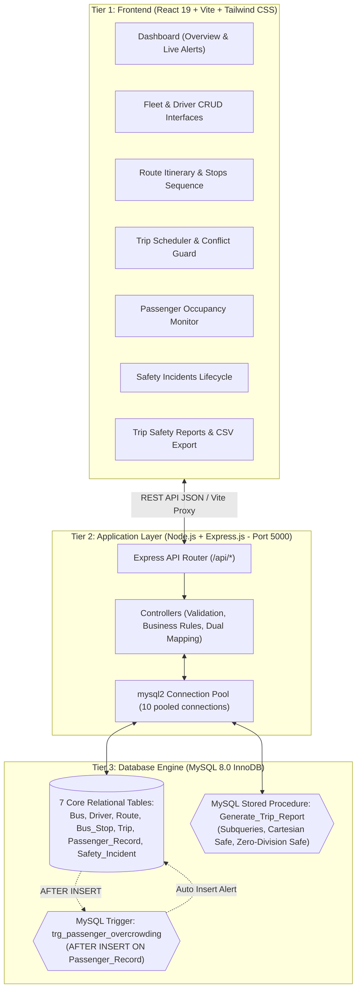

# Smart Bus Overcrowding & Passenger Safety Management System
**College DBMS Mini-Project | Full-Stack Web Application**

A database-driven public transport safety management platform built to prevent bus overcrowding, manage fleet inventory and commercial driver schedules, track passenger load snapshots across transit stops, and automatically detect safety violations using MySQL database triggers and stored procedures.

---

## Table of Contents
- [1. Societal Problem Addressed](#1-societal-problem-addressed)
- [2. System Architecture](#2-system-architecture)
- [3. Technology Stack](#3-technology-stack)
- [4. Frontend Pages & Modules](#4-frontend-pages--modules)
- [5. Database Schema & Key Logic](#5-database-schema--key-logic)
- [6. REST API Endpoints Summary](#6-rest-api-endpoints-summary)
- [7. Complete Setup & Execution Instructions](#7-complete-setup--execution-instructions)
- [8. Testing & Verification](#8-testing--verification)
- [9. Documentation Directory Index](#9-documentation-directory-index)
- [10. Team Responsibilities](#10-team-responsibilities)

---

## 1. Societal Problem Addressed
Public bus networks across urban and suburban corridors frequently experience severe overcrowding during morning and evening rush hours. Operating buses beyond authorized passenger capacities endangers public safety, leading to footboard accidents, door failures, vehicular instability, and passenger health emergencies. 

This system provides municipal and regional transit operators with automated passenger load monitoring, instant detection of overcrowding through database triggers, prompt incident resolution tracking, and trip performance analytics.

---

## 2. System Architecture

The application implements an industry-standard **3-Tier Client-Server Architecture**:



---

## 3. Technology Stack

### Frontend (Presentation Tier)
- **Library/Framework**: React 19 (`react`, `react-dom`)
- **Bundler & Dev Server**: Vite 8.x
- **Styling**: Tailwind CSS v4 (`@tailwindcss/vite`)
- **Routing**: React Router DOM v7
- **Icons**: Lucide React
- **HTTP Client**: Axios

### Backend (Application Tier)
- **Runtime**: Node.js (v18+ LTS)
- **Framework**: Express.js
- **Database Driver**: `mysql2` with connection pooling (`mysql2/promise`)
- **Environment Configuration**: `dotenv`
- **Request Logger**: `morgan` / custom structured logger
- **Cross-Origin Resource Sharing**: `cors` configured for React frontend

### Database (Data Tier)
- **RDBMS**: MySQL 8.0+
- **Storage Engine**: InnoDB (ACID compliant, foreign keys, row-level locking)
- **Automation**: MySQL Trigger (`trg_passenger_overcrowding`)
- **Reporting**: MySQL Stored Procedure (`Generate_Trip_Report`)

---

## 4. Frontend Pages & Modules

| Route | Page Component | Features |
| :--- | :--- | :--- |
| `/` | `Dashboard.jsx` | Overview cards (Total Buses, Today's Trips, Overcrowded Trips, Open Incidents), Recent Trips feed, and active Safety Alert banners. |
| `/buses` | `Buses.jsx` | Bus inventory management. Search, add, edit, and delete buses with seating capacity, type, and status badges. |
| `/drivers` | `Drivers.jsx` | Commercial driver registry. Manage names, 10-digit phone numbers, and driving license numbers with duplicate checks. |
| `/routes` | `Routes.jsx` | Route configuration. Manage source, destination, distance, and comma-separated intermediate transit stops in sequence. |
| `/trips` | `Trips.jsx` | Dispatch board. Schedule trips pairing buses, drivers, routes, dates, and times with scheduling collision prevention. |
| `/passengers` | `PassengerMonitoring.jsx` | Real-time passenger snapshot entry. Dynamically displays occupancy percentage bar, changing from green to red when capacity is breached. |
| `/incidents` | `SafetyIncidents.jsx` | Safety incidents queue. Review trigger-generated overcrowding alerts and manual incidents; resolve incidents with one click. |
| `/reports` | `TripReport.jsx` | Trip performance viewer. Inspect peak passenger count, occupancy rate, and safety incidents computed by MySQL stored procedure; includes CSV export. |

---

## 5. Database Schema & Key Logic

The database `smart_bus_safety` consists of exactly **7 core tables**:

| Table | Purpose | Primary Key | Foreign Keys & Key Constraints |
| :--- | :--- | :---: | :--- |
| **`Bus`** | Fleet inventory & legal seating capacity | `bus_id` | `UNIQUE (bus_number)`, `CHECK (capacity > 0)`, `CHECK (status IN ('Active', 'Maintenance', 'Inactive'))` |
| **`Driver`** | Certified commercial drivers & duty status | `driver_id` | `UNIQUE (phone)`, `UNIQUE (license_no)`, `CHECK (status IN ('Available', 'On Duty', 'Inactive', 'Active'))` |
| **`Route`** | Origin-to-destination transit lines | `route_id` | `CHECK (distance_km > 0)` |
| **`Bus_Stop`** | Sequentially ordered route stops | `stop_id` | `FK -> Route(route_id) ON DELETE CASCADE`, `UNIQUE (route_id, stop_order)` |
| **`Trip`** | Scheduled bus, driver, and route dispatch | `trip_id` | `FK -> Bus, Driver, Route ON DELETE RESTRICT`, `CHECK (end_time > start_time)` |
| **`Passenger_Record`** | Point-in-time passenger occupancy snapshot | `record_id` | `FK -> Trip(trip_id) ON DELETE RESTRICT`, `CHECK (passenger_count >= 0)` |
| **`Safety_Incident`** | Trigger-generated and manual safety events | `incident_id` | `FK -> Trip(trip_id) ON DELETE RESTRICT`, severity & status checks, timestamped resolution |

### Database Trigger: `trg_passenger_overcrowding`
- **Timing**: `AFTER INSERT ON Passenger_Record`
- **Logic**: Compares `NEW.passenger_count` with the assigned bus capacity. If exceeded, it checks whether an unresolved (`Open` or `Investigating`) incident already exists for that trip. If none exists, it automatically inserts a `High` severity `Open` incident into `Safety_Incident`.

### Stored Procedure: `Generate_Trip_Report`
- **Signature**: `CALL Generate_Trip_Report(p_trip_id);`
- **Logic**: Uses isolated derived subqueries (`p_agg` and `i_agg`) to aggregate total records, maximum passenger load, average passengers, and incident counts, completely eliminating Cartesian duplicate errors.

---

## 6. REST API Endpoints Summary

All API endpoints reside under `http://localhost:5000/api` and return standardized JSON: `{ success: true, message: "...", data: ... }`.

| Domain | Method | Endpoint | Description |
| :--- | :---: | :--- | :--- |
| **System** | `GET` | `/health` | Server operational status and uptime |
| **Dashboard** | `GET` | `/dashboard` | Live statistics and unresolved alerts |
| **Buses** | `GET` | `/buses` | List all buses (supports `?status=` and `?bus_type=`) |
| | `POST` | `/buses` | Register new bus (validates capacity > 0) |
| | `PUT` | `/buses/:id` | Update bus details |
| | `DELETE` | `/buses/:id` | Delete bus (protected if trips exist) |
| **Drivers** | `GET` | `/drivers` | List all drivers (supports `?status=`) |
| | `POST` | `/drivers` | Register new driver (unique phone & license checks) |
| | `PUT` | `/drivers/:id` | Update driver details |
| | `DELETE` | `/drivers/:id` | Delete driver (protected if trips exist) |
| **Routes** | `GET` | `/routes` | List routes with total bus stop count |
| | `GET` | `/routes/:id` | Get route with its ordered sequential stops |
| | `POST` | `/routes` | Create route with nested ordered stops (atomic transaction) |
| | `DELETE` | `/routes/:id` | Delete route (cascades to stops; protected if trips exist) |
| **Trips** | `GET` | `/trips` | List trips with joined bus, driver, and route metadata |
| | `POST` | `/trips` | Schedule trip (prevents scheduling collisions) |
| | `PUT` | `/trips/:id` | Update trip status / timings |
| | `DELETE` | `/trips/:id` | Delete trip (protected against dependent records) |
| **Passengers** | `GET` | `/passengers/:tripId` | Get journey occupancy snapshots with calculated % |
| | `POST` | `/passengers` | Record point-in-time passenger count (**fires MySQL trigger**) |
| **Incidents** | `GET` | `/incidents` | List safety incidents (filter by status/severity/type) |
| | `PATCH` | `/incidents/:id/status` | Transition status (`Open`, `Investigating`, `Resolved`) |
| | `POST` | `/incidents` | Manually log safety incident (Accident, Medical, etc.) |
| **Reports** | `GET` | `/reports/trip/:tripId` | Runs stored procedure `Generate_Trip_Report` |

---

## 7. Complete Setup & Execution Instructions

### Prerequisites
- Node.js (v18.x or v20.x+ LTS)
- MySQL Server 8.0+ (or XAMPP)
- MySQL Workbench or MySQL CLI

### Step 1: Database Setup
Execute the SQL files in this exact sequence:

```powershell
# Open terminal in database folder
cd smart-bus-safety/database

# 1. Create database schema & 7 tables
mysql -u root -p < schema.sql

# 2. Insert sample fleet & trip data
mysql -u root -p smart_bus_safety < seed.sql

# 3. Create overcrowding trigger
mysql -u root -p smart_bus_safety < trigger.sql

# 4. Create trip report stored procedure
mysql -u root -p smart_bus_safety < procedures.sql
```
*(Alternatively, open each SQL file in MySQL Workbench and click the Lightning Bolt to execute).*

### Step 2: Start Backend API Server
```powershell
cd ../backend

# Install backend dependencies (if not already installed)
npm install

# Create environment configuration file from template
copy .env.example .env

# Edit .env with your local MySQL password:
# DB_PASSWORD=your_mysql_password

# Start backend in development mode (port 5000)
npm run dev
```

### Step 3: Start Frontend Web Application
Open a **new terminal window**:
```powershell
cd ../frontend

# Install frontend dependencies (if not already installed)
npm install

# Start Vite development server (port 5173)
npm run dev
```

### Step 4: Open Application in Browser
- **Frontend Web UI**: [http://localhost:5173](http://localhost:5173)
- **Backend Health Check**: [http://localhost:5000/api/health](http://localhost:5000/api/health)
- **Dashboard API**: [http://localhost:5000/api/dashboard](http://localhost:5000/api/dashboard)

---

## 8. Testing & Verification

### Automated Backend Tests
Run the automated test suite in `smart-bus-safety/backend`:
```powershell
cd smart-bus-safety/backend
npm test
```
*Verifies static syntax, middleware functions, controller methods, and route registration.*

### Production Frontend Build Verification
```powershell
cd smart-bus-safety/frontend
npm run build
```
*Compiles all 2,131 React modules into production assets with 0 errors.*

### Testing the MySQL Overcrowding Trigger
1. In the Web UI, navigate to **Passenger Monitoring** (`/passengers`).
2. Select a bus (e.g., `KA-19-1234` with capacity 45).
3. Input a passenger count of `55` (55 > 45) and click **Record Passenger Count**.
4. Observe the gauge turns red with the alert **Overcrowding Detected!**.
5. Navigate to **Safety Incidents** (`/incidents`): The MySQL trigger has automatically created an `Open`, `High` severity incident.
6. Click **Resolve** to mark it resolved (records `resolved_at = NOW()`).

---

## 9. Documentation Directory Index

Comprehensive references are provided in the [`docs/`](file:///e:/SCEM%20Notes/5th%20sem/Assignments/smart-bus-safety/docs) folder:

- **[DATABASE_DOCUMENTATION.md](file:///e:/SCEM%20Notes/5th%20sem/Assignments/smart-bus-safety/docs/DATABASE_DOCUMENTATION.md)**: Deep dive into all 7 tables, data types, constraints, trigger mechanics, and stored procedures.
- **[SYSTEM_WORKFLOW_DOCUMENTATION.md](file:///e:/SCEM%20Notes/5th%20sem/Assignments/smart-bus-safety/docs/SYSTEM_WORKFLOW_DOCUMENTATION.md)**: Complete sequence diagrams, transaction flows, and viva exam defense Q&A.
- **[API_DOCUMENTATION.md](file:///e:/SCEM%20Notes/5th%20sem/Assignments/smart-bus-safety/docs/API_DOCUMENTATION.md)**: REST API reference with full request/response JSON schemas.
- **[SETUP_GUIDE.md](file:///e:/SCEM%20Notes/5th%20sem/Assignments/smart-bus-safety/docs/SETUP_GUIDE.md)**: Beginner-friendly installation manual with troubleshooting steps.
- **[MEMBER_A_HANDOVER.md](file:///e:/SCEM%20Notes/5th%20sem/Assignments/smart-bus-safety/docs/MEMBER_A_HANDOVER.md)**: Integration agreement and TypeScript data contracts.
- **[erd.md](file:///e:/SCEM%20Notes/5th%20sem/Assignments/smart-bus-safety/database/erd.md)**: Entity-Relationship diagram and cardinality tables.
- **[api-test-checklist.md](file:///e:/SCEM%20Notes/5th%20sem/Assignments/smart-bus-safety/backend/tests/api-test-checklist.md)**: 10-phase verification checklist.

---

## 10. Team Responsibilities

- **Member A (Database Engineer & Backend Developer)**:
  - Database schema, table normalization (3NF), indexing, and foreign key constraints.
  - Realistic Karnataka transit seed data.
  - MySQL Trigger `trg_passenger_overcrowding` with duplicate alert suppression.
  - MySQL Stored Procedure `Generate_Trip_Report` with Cartesian product prevention.
  - Express.js REST API with connection pooling and centralized error handling.
  - Backend documentation, automated testing scripts, and handover contracts.

- **Member B (Frontend Developer)**:
  - Responsive web interface using React 19, Vite, and Tailwind CSS.
  - Admin dashboard displaying real-time metrics and alerts.
  - CRUD management screens for buses, drivers, routes, and trips.
  - Live passenger snapshot monitoring screen with dynamic occupancy bar.
  - Safety incident tracking and resolution interface.
  - Stored procedure trip performance report viewer with CSV export.
