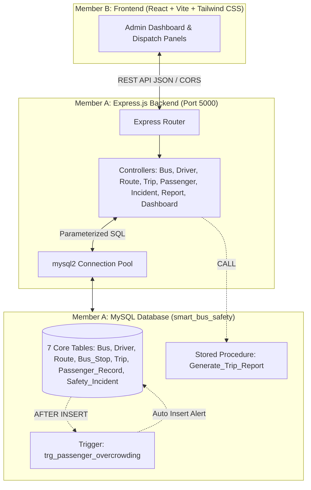

# Smart Bus Overcrowding & Passenger Safety Management System
**College DBMS Mini-Project | Backend & Database Implementation**

A database-driven web platform designed to prevent transit overcrowding, maintain fleet and crew records, schedule public bus operations, and automatically flag safety violations using MySQL database triggers and stored procedures.

---

## 1. Societal Problem Addressed
Public bus networks across urban and suburban corridors frequently experience severe overcrowding during morning and evening rush hours. Operating buses beyond authorized passenger capacities endangers public safety, leading to footboard accidents, door failures, vehicular instability, and passenger health emergencies. 

This system provides municipal and regional transit operators with automated passenger load monitoring, instant detection of overcrowding through database triggers, prompt incident resolution tracking, and trip performance analytics.

---

## 2. Key Features
- **Fleet & Crew Management**: Track buses, capacities, fuel/powertrain types, and driver license/duty records.
- **Route & Sequential Stop Scheduling**: Model transit routes and their ordered stop sequences.
- **Trip Scheduling & Conflict Prevention**: Assign buses and drivers to routes while preventing double-booking collisions.
- **Point-in-Time Passenger Occupancy Snapshots**: Monitor actual passenger counts at transit stops.
- **Automated MySQL Overcrowding Trigger (`trg_passenger_overcrowding`)**: Automatically triggers a High-severity safety alert directly inside the database whenever onboard passenger counts exceed vehicle capacity, with smart duplicate prevention.
- **Comprehensive Stored Procedure (`Generate_Trip_Report`)**: Produces trip performance, maximum occupancy percentages, and safety summaries using isolated subquery aggregations that eliminate Cartesian product errors.
- **Live Database-Driven Dashboard**: Aggregates real-time fleet, trip, and incident statistics.
- **RESTful API**: Documented endpoints returning clean JSON responses with comprehensive validation.

---

## 3. Technology Stack

- **Database**: MySQL 8.0+ (InnoDB Storage Engine)
- **Runtime**: Node.js (v18+)
- **Backend Framework**: Express.js
- **Database Driver**: `mysql2` with connection pooling (`mysql2/promise`)
- **Environment Management**: `dotenv`
- **Request Logging**: `morgan` / structured console logging
- **CORS Support**: `cors` configured for React frontend integration
- **Development Tooling**: `nodemon`

---

## 4. System Architecture



---

## 5. Database Tables & Key Logic

| Table | Purpose | Key Constraints |
| :--- | :--- | :--- |
| **`Bus`** | Fleet inventory & passenger capacity | Unique bus number, `capacity > 0`, status checks |
| **`Driver`** | Driver details and availability | Unique phone and license number, status checks |
| **`Route`** | Origin and destination corridors | `distance_km > 0` |
| **`Bus_Stop`** | Ordered sequence of stops per route | Unique `(route_id, stop_order)`, cascades on route deletion |
| **`Trip`** | Scheduled bus, driver, and route pairing | Referential integrity, `end_time > start_time` |
| **`Passenger_Record`** | Point-in-time passenger count snapshot | `passenger_count >= 0`, `recorded_at` timestamp |
| **`Safety_Incident`** | Manual and trigger-generated incidents | Severity tiers, status tracking, timestamped resolution |

### Database Trigger: `trg_passenger_overcrowding`
- **Timing**: `AFTER INSERT ON Passenger_Record`
- **Action**: Compares `NEW.passenger_count` with the assigned bus capacity. If exceeded and no unresolved Overcrowding incident currently exists for that trip, an incident is created automatically.

### Stored Procedure: `Generate_Trip_Report`
- **Usage**: `CALL Generate_Trip_Report(trip_id);`
- **Action**: Safely aggregates total records, peak passenger count, average passenger count, maximum occupancy percentage, and total incident counts without Cartesian duplicates.

---

## 6. Quick Setup & Installation

### Step 1: Initialize Database (MySQL 8.0+)
Open MySQL Workbench or CLI and run scripts in this exact order:
```powershell
cd smart-bus-safety/database
mysql -u root -p < schema.sql
mysql -u root -p smart_bus_safety < seed.sql
mysql -u root -p smart_bus_safety < trigger.sql
mysql -u root -p smart_bus_safety < procedures.sql
```

### Step 2: Configure & Start Backend
```powershell
cd ../backend
npm install
copy .env.example .env
# Edit .env with your local MySQL password
npm run dev
```

### Step 3: Verify Installation
Open `http://localhost:5000/api/health` in your browser.

---

## 7. REST API Endpoints Summary

| Module | Method | Endpoint | Description |
| :--- | :---: | :--- | :--- |
| **Health** | `GET` | `/api/health` | Backend status and uptime |
| **Dashboard** | `GET` | `/api/dashboard` | Live fleet, trip, and incident statistics |
| **Buses** | `GET` | `/api/buses` | List buses (filters by status/type) |
| | `POST` | `/api/buses` | Register new bus |
| | `PUT` | `/api/buses/:id` | Update bus details |
| | `DELETE` | `/api/buses/:id` | Remove bus (protected against referenced trips) |
| **Drivers** | `GET` | `/api/drivers` | List drivers (filters by status) |
| | `POST` | `/api/drivers` | Register new driver |
| | `PUT` | `/api/drivers/:id` | Update driver details |
| | `DELETE` | `/api/drivers/:id` | Remove driver (protected against referenced trips) |
| **Routes** | `GET` | `/api/routes` | List routes with stop counts |
| | `GET` | `/api/routes/:id` | Get route with ordered stop sequence |
| | `POST` | `/api/routes` | Create route with nested stop array |
| **Trips** | `GET` | `/api/trips` | List trips with joined bus, driver, and route metadata |
| | `POST` | `/api/trips` | Schedule new trip with conflict prevention |
| | `PUT` | `/api/trips/:id` | Update trip status / timings |
| **Passengers** | `GET` | `/api/passengers/trip/:tripId` | Get journey occupancy snapshots with calculated % |
| | `POST` | `/api/passengers` | Record passenger snapshot (activates MySQL trigger) |
| **Incidents** | `GET` | `/api/incidents` | List safety incidents (filter by status/severity/type) |
| | `PATCH` | `/api/incidents/:id/status` | Update incident status (`Open`, `Investigating`, `Resolved`) |
| | `POST` | `/api/incidents` | Log manual incident (Accident, Medical, etc.) |
| **Reports** | `GET` | `/api/reports/trip/:tripId` | Run MySQL Stored Procedure and return report JSON |

---

## 8. Team Division & Responsibilities

- **Member A (Database Engineer & Backend Developer)**:
  - Database schema, indexing, and foreign key architecture.
  - Realistic Karnataka transit seed data.
  - MySQL Trigger for automated overcrowding detection with duplicate prevention.
  - MySQL Stored Procedure for comprehensive trip safety reporting.
  - Express.js REST API with connection pooling and centralized error handling.
  - Documentation (`API_DOCUMENTATION.md`, `DATABASE_DOCUMENTATION.md`, `SETUP_GUIDE.md`, `MEMBER_A_HANDOVER.md`).
- **Member B (Frontend Developer)**:
  - React + Vite + Tailwind CSS web interface.
  - Operator dashboard with safety metrics.
  - CRUD interfaces for buses, drivers, routes, and trips.
  - Passenger occupancy snapshot entry screen with live visual overcrowding alert indicators.
  - Incident resolution panel and printable trip safety reports.

