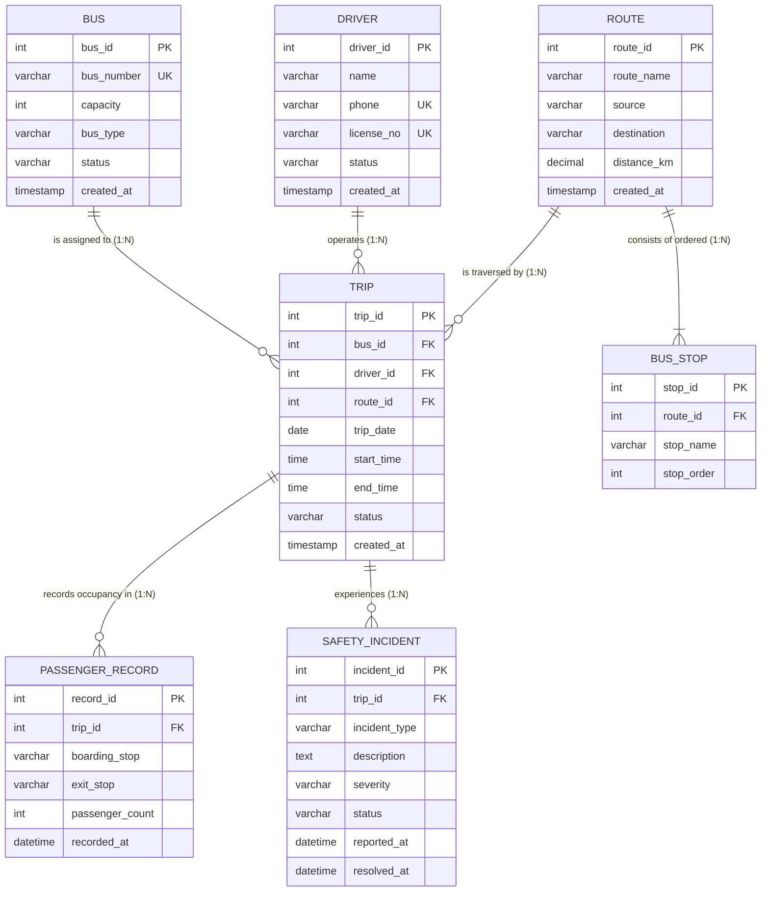

# Entity-Relationship (ER) Documentation
## Smart Bus Overcrowding & Passenger Safety Management System

This document outlines the conceptual and logical entity-relationship model for the `smart_bus_safety` MySQL database, detailing entities, primary keys, foreign keys, constraints, and cardinalities.

---

## 1. Entity-Relationship Diagram (ERD)

---

## 2. Cardinality and Relationship Details

| Relationship | Entities Involved | Cardinality | Foreign Key Constraint | Description |
| :--- | :--- | :---: | :--- | :--- |
| **Bus to Trip** | `Bus` (1) to `Trip` (M) | **1 : N** | `Trip.bus_id` &rarr; `Bus.bus_id` (`ON DELETE RESTRICT`) | A bus can be assigned to multiple scheduled trips over time. A trip must have exactly one assigned bus. A bus cannot be deleted if past trips reference it. |
| **Driver to Trip** | `Driver` (1) to `Trip` (M) | **1 : N** | `Trip.driver_id` &rarr; `Driver.driver_id` (`ON DELETE RESTRICT`) | A driver can operate multiple scheduled trips across days. A trip is driven by exactly one driver. Referenced drivers cannot be deleted. |
| **Route to Trip** | `Route` (1) to `Trip` (M) | **1 : N** | `Trip.route_id` &rarr; `Route.route_id` (`ON DELETE RESTRICT`) | A designated route can have multiple daily trips scheduled on it. A trip adheres to exactly one route. |
| **Route to Bus Stop** | `Route` (1) to `Bus_Stop` (M) | **1 : N** | `Bus_Stop.route_id` &rarr; `Route.route_id` (`ON DELETE CASCADE`) | A route consists of one or more sequential bus stops (`stop_order` 1, 2, 3...). If a route is removed, its constituent stops are cascaded. |
| **Trip to Passenger Record** | `Trip` (1) to `Passenger_Record` (M) | **1 : N** | `Passenger_Record.trip_id` &rarr; `Trip.trip_id` (`ON DELETE RESTRICT`) | During a trip's progression from source to destination, passenger occupancy snapshots are recorded at stops. |
| **Trip to Safety Incident** | `Trip` (1) to `Safety_Incident` (M) | **1 : N** | `Safety_Incident.trip_id` &rarr; `Trip.trip_id` (`ON DELETE RESTRICT`) | A trip may encounter safety incidents, either triggered automatically by passenger overcrowding or logged manually (e.g., accidents, medical distress). |

---

## 3. Entity Attributes & Constraints

### 1. `Bus`
- **`bus_id`**: Integer, Auto-increment, **Primary Key**.
- **`bus_number`**: `VARCHAR(20)`, **Unique**, Not Null (e.g., `KA-19-F-1204`).
- **`capacity`**: Integer, Not Null, `CHECK (capacity > 0)`.
- **`bus_type`**: `VARCHAR(30)`, Not Null, `CHECK (bus_type IN ('Ordinary', 'Express', 'AC', 'Electric'))`.
- **`status`**: `VARCHAR(20)`, Default `'Active'`, `CHECK (status IN ('Active', 'Maintenance', 'Inactive'))`.

### 2. `Driver`
- **`driver_id`**: Integer, Auto-increment, **Primary Key**.
- **`name`**: `VARCHAR(100)`, Not Null.
- **`phone`**: `VARCHAR(15)`, **Unique**, Not Null.
- **`license_no`**: `VARCHAR(50)`, **Unique**, Not Null.
- **`status`**: `VARCHAR(20)`, Default `'Available'`, `CHECK (status IN ('Available', 'On Duty', 'Inactive'))`.

### 3. `Route`
- **`route_id`**: Integer, Auto-increment, **Primary Key**.
- **`route_name`**: `VARCHAR(100)`, Not Null (e.g., `Route 15: State Bank to Surathkal`).
- **`source`**: `VARCHAR(100)`, Not Null (e.g., `State Bank, Mangaluru`).
- **`destination`**: `VARCHAR(100)`, Not Null (e.g., `Surathkal Bus Stand`).
- **`distance_km`**: `DECIMAL(7, 2)`, Nullable, `CHECK (distance_km > 0)`.

### 4. `Bus_Stop`
- **`stop_id`**: Integer, Auto-increment, **Primary Key**.
- **`route_id`**: Integer, **Foreign Key** referencing `Route(route_id)`.
- **`stop_name`**: `VARCHAR(100)`, Not Null (e.g., `Kottara Chowki`).
- **`stop_order`**: Integer, Not Null (`1, 2, 3...`).
- **Composite Unique Constraint**: `UNIQUE (route_id, stop_order)` ensures strict sequential ordering without duplicates.

### 5. `Trip`
- **`trip_id`**: Integer, Auto-increment, **Primary Key**.
- **`bus_id`**: Integer, **Foreign Key** referencing `Bus(bus_id)`.
- **`driver_id`**: Integer, **Foreign Key** referencing `Driver(driver_id)`.
- **`route_id`**: Integer, **Foreign Key** referencing `Route(route_id)`.
- **`trip_date`**: `DATE`, Not Null.
- **`start_time`**: `TIME`, Not Null.
- **`end_time`**: `TIME`, Nullable.
- **`status`**: `VARCHAR(20)`, Default `'Scheduled'`, `CHECK (status IN ('Scheduled', 'In Progress', 'Completed', 'Cancelled'))`.
- **Temporal Constraint**: `CHECK (end_time IS NULL OR end_time > start_time)`.

### 6. `Passenger_Record`
- **`record_id`**: Integer, Auto-increment, **Primary Key**.
- **`trip_id`**: Integer, **Foreign Key** referencing `Trip(trip_id)`.
- **`boarding_stop`**: `VARCHAR(100)`, Not Null.
- **`exit_stop`**: `VARCHAR(100)`, Nullable.
- **`passenger_count`**: Integer, Not Null, `CHECK (passenger_count >= 0)`.
  > **Note on Semantics**: `passenger_count` represents a point-in-time snapshot of the total passenger count onboard the vehicle upon departing the specified stop. It is NOT incremental boarding.
- **`recorded_at`**: `DATETIME`, Default `CURRENT_TIMESTAMP`.

### 7. `Safety_Incident`
- **`incident_id`**: Integer, Auto-increment, **Primary Key**.
- **`trip_id`**: Integer, **Foreign Key** referencing `Trip(trip_id)`.
- **`incident_type`**: `VARCHAR(50)`, Not Null, `CHECK (incident_type IN ('Overcrowding', 'Accident', 'Medical Emergency', 'Passenger Safety', 'Other'))`.
- **`description`**: `TEXT`, Nullable.
- **`severity`**: `VARCHAR(20)`, Default `'Medium'`, `CHECK (severity IN ('Low', 'Medium', 'High', 'Critical'))`.
- **`status`**: `VARCHAR(30)`, Default `'Open'`, `CHECK (status IN ('Open', 'Investigating', 'Resolved'))`.
- **`reported_at`**: `DATETIME`, Default `CURRENT_TIMESTAMP`.
- **`resolved_at`**: `DATETIME`, Nullable.

---

## 4. Deletion and Integrity Policy

To prevent orphan records and retain audit trails for passenger safety analysis:
1. Deleting a `Bus`, `Driver`, `Route`, or `Trip` with dependent records is restricted at both the database level (`ON DELETE RESTRICT`) and application level (clear HTTP 409 Conflict response).
2. Deleting a `Route` cascades only to its `Bus_Stop` sequence, as bus stops are purely route-dependent lookup nodes. If any `Trip` references that route, deletion is restricted.
