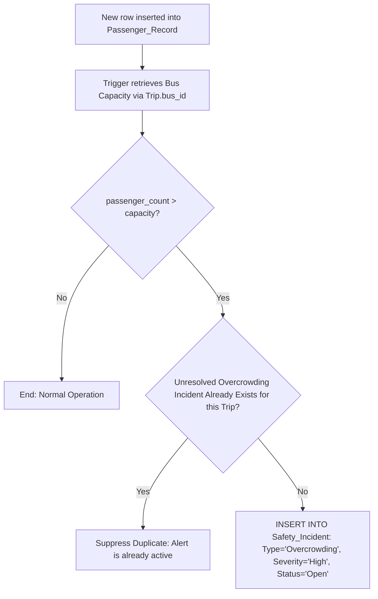

# Database Documentation & Viva Reference
## Smart Bus Overcrowding & Passenger Safety Management System
**Database Name**: `smart_bus_safety`  
**Engine**: MySQL 8.0+ (InnoDB)  
**Member A: Database Engineer & Backend Developer**

---

## 1. Overview and Problem Context
Urban and suburban public transport networks frequently face sudden surges in passenger occupancy during peak hours, causing buses to run dangerously overcrowded. Overcrowding compromises vehicular braking, creates passenger safety hazards (door falls, suffocation, crush injuries), and leads to route delays.

The `smart_bus_safety` relational database serves as the centralized core of a safety management platform. It tracks buses, drivers, routes, stops, schedules trips, records point-in-time passenger counts at transit stops, dynamically catches overcrowding via a **MySQL Trigger**, and calculates analytical performance summaries through a **MySQL Stored Procedure**.

---

## 2. Relational Schema Architecture (7 Core Tables)

### Table 1: `Bus`
Stores transit vehicle fleet information, authorized legal capacities, and operational status.
- `bus_id`: `INT AUTO_INCREMENT PRIMARY KEY`
- `bus_number`: `VARCHAR(20) NOT NULL UNIQUE` (e.g., `KA-19-F-1101`)
- `capacity`: `INT NOT NULL`, with `CHECK (capacity > 0)`
- `bus_type`: `VARCHAR(30) NOT NULL`, with `CHECK (bus_type IN ('Ordinary', 'Express', 'AC', 'Electric'))`
- `status`: `VARCHAR(20) NOT NULL DEFAULT 'Active'`, with `CHECK (status IN ('Active', 'Maintenance', 'Inactive'))`
- `created_at`: `TIMESTAMP DEFAULT CURRENT_TIMESTAMP`
- **Indexes**: `idx_bus_status` on (`status`)

### Table 2: `Driver`
Maintains verified commercial drivers, licenses, and availability.
- `driver_id`: `INT AUTO_INCREMENT PRIMARY KEY`
- `name`: `VARCHAR(100) NOT NULL`
- `phone`: `VARCHAR(15) NOT NULL UNIQUE`
- `license_no`: `VARCHAR(50) NOT NULL UNIQUE`
- `status`: `VARCHAR(20) NOT NULL DEFAULT 'Available'`, with `CHECK (status IN ('Available', 'On Duty', 'Inactive'))`
- `created_at`: `TIMESTAMP DEFAULT CURRENT_TIMESTAMP`
- **Indexes**: `idx_driver_status` on (`status`)

### Table 3: `Route`
Defines fixed origin-to-destination transit corridors.
- `route_id`: `INT AUTO_INCREMENT PRIMARY KEY`
- `route_name`: `VARCHAR(100) NOT NULL`
- `source`: `VARCHAR(100) NOT NULL`
- `destination`: `VARCHAR(100) NOT NULL`
- `distance_km`: `DECIMAL(7, 2) NULL`, with `CHECK (distance_km IS NULL OR distance_km > 0)`
- `created_at`: `TIMESTAMP DEFAULT CURRENT_TIMESTAMP`
- **Indexes**: `idx_route_source_dest` on (`source`, `destination`)

### Table 4: `Bus_Stop`
Stores the sequential stops that comprise a transit route.
- `stop_id`: `INT AUTO_INCREMENT PRIMARY KEY`
- `route_id`: `INT NOT NULL`, `FOREIGN KEY` referencing `Route(route_id) ON DELETE CASCADE ON UPDATE CASCADE`
- `stop_name`: `VARCHAR(100) NOT NULL`
- `stop_order`: `INT NOT NULL`, with `CHECK (stop_order > 0)`
- **Constraints**: `UNIQUE (route_id, stop_order)` prevents two stops on the same route having conflicting sequence indices.
- **Indexes**: `idx_bus_stop_route` on (`route_id`)

### Table 5: `Trip`
Schedules an assigned Bus and Driver across a Route on a specific date and time.
- `trip_id`: `INT AUTO_INCREMENT PRIMARY KEY`
- `bus_id`: `INT NOT NULL`, `FOREIGN KEY` referencing `Bus(bus_id) ON DELETE RESTRICT`
- `driver_id`: `INT NOT NULL`, `FOREIGN KEY` referencing `Driver(driver_id) ON DELETE RESTRICT`
- `route_id`: `INT NOT NULL`, `FOREIGN KEY` referencing `Route(route_id) ON DELETE RESTRICT`
- `trip_date`: `DATE NOT NULL`
- `start_time`: `TIME NOT NULL`
- `end_time`: `TIME NULL`
- `status`: `VARCHAR(20) NOT NULL DEFAULT 'Scheduled'`, with `CHECK (status IN ('Scheduled', 'In Progress', 'Completed', 'Cancelled'))`
- `created_at`: `TIMESTAMP DEFAULT CURRENT_TIMESTAMP`
- **Constraints**: `CHECK (end_time IS NULL OR end_time > start_time)`
- **Indexes**: `idx_trip_bus`, `idx_trip_driver`, `idx_trip_route`, `idx_trip_date_status`

### Table 6: `Passenger_Record`
Stores point-in-time passenger occupancy snapshots captured during journey milestones.
> **Important Semantics**: `passenger_count` represents the total number of passengers present inside the bus upon departure from the stop. It is NOT incremental boarding.
- `record_id`: `INT AUTO_INCREMENT PRIMARY KEY`
- `trip_id`: `INT NOT NULL`, `FOREIGN KEY` referencing `Trip(trip_id) ON DELETE RESTRICT`
- `boarding_stop`: `VARCHAR(100) NOT NULL`
- `exit_stop`: `VARCHAR(100) NULL`
- `passenger_count`: `INT NOT NULL`, with `CHECK (passenger_count >= 0)`
- `recorded_at`: `DATETIME NOT NULL DEFAULT CURRENT_TIMESTAMP`
- **Indexes**: `idx_passenger_trip`, `idx_passenger_recorded_at`

### Table 7: `Safety_Incident`
Logs passenger safety events, including automatic alerts spawned by database triggers.
- `incident_id`: `INT AUTO_INCREMENT PRIMARY KEY`
- `trip_id`: `INT NOT NULL`, `FOREIGN KEY` referencing `Trip(trip_id) ON DELETE RESTRICT`
- `incident_type`: `VARCHAR(50) NOT NULL`, with `CHECK (incident_type IN ('Overcrowding', 'Accident', 'Medical Emergency', 'Passenger Safety', 'Other'))`
- `description`: `TEXT NULL`
- `severity`: `VARCHAR(20) NOT NULL DEFAULT 'Medium'`, with `CHECK (severity IN ('Low', 'Medium', 'High', 'Critical'))`
- `status`: `VARCHAR(30) NOT NULL DEFAULT 'Open'`, with `CHECK (status IN ('Open', 'Investigating', 'Resolved'))`
- `reported_at`: `DATETIME NOT NULL DEFAULT CURRENT_TIMESTAMP`
- `resolved_at`: `DATETIME NULL`
- **Indexes**: `idx_incident_trip`, `idx_incident_status_severity`, `idx_incident_type`

---

## 3. Database Trigger: `trg_passenger_overcrowding`

### Definition & Timing
- **Name**: `trg_passenger_overcrowding`
- **Timing**: `AFTER INSERT ON Passenger_Record`
- **Location**: `database/trigger.sql`

### How It Works:


### Duplicate Alert Prevention Strategy:
During peak hours, an overloaded bus might record high counts across 3 consecutive stops. If an incident were inserted each time, transport dispatchers would be flooded with duplicate alerts for the same situation.
- The trigger executes a check:
  ```sql
  SELECT COUNT(*) INTO v_active_incident_count
  FROM Safety_Incident
  WHERE trip_id = NEW.trip_id
    AND incident_type = 'Overcrowding'
    AND status IN ('Open', 'Investigating');
  ```
- If an alert is already active (`Open` or `Investigating`), duplicate insertion is suppressed.
- Once that incident is marked `Resolved` by the supervisor, a subsequent overcrowded snapshot will legitimately generate a new incident.

---

## 4. Stored Procedure: `Generate_Trip_Report(p_trip_id)`

### Definition & Signatures
- **Name**: `Generate_Trip_Report`
- **Parameter**: `IN p_trip_id INT`
- **Location**: `database/procedures.sql`

### Avoiding the Cartesian Product Problem
Joining multiple one-to-many child tables (`Passenger_Record` and `Safety_Incident`) simultaneously to `Trip` multiplies row counts, corrupting `COUNT()` and `AVG()` values.  
**Solution**: We pre-aggregate passenger snapshots and safety incidents in isolated derived subqueries (`p_agg` and `i_agg`), then `LEFT JOIN` those subqueries onto `Trip`:
```sql
LEFT JOIN (
    SELECT trip_id, COUNT(record_id) AS total_passenger_records,
           MAX(passenger_count) AS maximum_passengers,
           AVG(passenger_count) AS average_passengers
    FROM Passenger_Record
    WHERE trip_id = p_trip_id
    GROUP BY trip_id
) p_agg ON t.trip_id = p_agg.trip_id
```

### Safe Computations
- `COALESCE` replaces `NULL` with `0` for newly scheduled trips that have no records yet.
- Prevents division by zero:
  ```sql
  ROUND(
      CASE 
          WHEN b.capacity > 0 AND p_agg.maximum_passengers IS NOT NULL 
          THEN (p_agg.maximum_passengers / b.capacity) * 100.0
          ELSE 0.00 
      END, 2
  ) AS maximum_occupancy_percentage
  ```

---

## 5. Key Analytical Queries (`queries.sql`)
The project provides 12 practical queries covering:
1. Active fleet status and capacity.
2. Available drivers for dispatch.
3. Formatted transit itinerary using `GROUP_CONCAT`.
4. Dispatch board using 4-way `INNER JOIN`.
5. Direct identification of overloaded passenger snapshots.
6. Occupancy tier classification using `CASE` expressions.
7. Total route kilometers and trip frequency.
8. Safety incident severity cross-tabulation.
9. Dispatcher queue of active unresolved alerts.
10. Route-wise safety performance summary.
11. Identification of the busiest boarding stops.
12. Driver safety profile and completed trips.

---

## 6. Assumptions and Technical Boundaries
1. **Scope Exclusions**: Real-time GPS streams, mobile passenger ticketing, passenger payment gateways, and hardware weight sensors are excluded by design.
2. **Occupancy Snapshot Semantics**: `passenger_count` represents a true point-in-time vehicle census, not incremental boardings.
3. **Trip Scheduling Scope**: Overnight trips crossing midnight are excluded to keep scheduling logic straightforward and explainable in viva.
4. **Referential Integrity**: Hard deletion of buses, drivers, and routes having past trip histories is strictly blocked to maintain safety and compliance audit trails.

