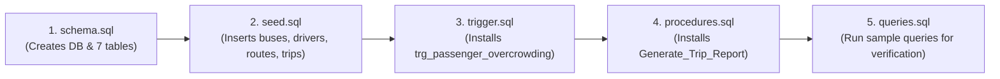

# Complete Installation & Setup Guide
## Smart Bus Overcrowding & Passenger Safety Management System
**Member A: Database Engineer & Backend Developer**

This beginner-friendly guide walks through the complete setup of the MySQL database and Express.js backend on Windows and macOS/Linux.

---

## 1. Prerequisites Checklist
Ensure the following tools are installed on your workstation:
1. **Node.js** (v18.x, v20.x, or v22.x+ LTS): [Download Node.js](https://nodejs.org/)
2. **MySQL Server 8.0+** or **XAMPP / MariaDB**: [Download MySQL Community Server](https://dev.mysql.com/downloads/installer/)
3. **MySQL Workbench** or any visual SQL client (DBeaver, phpMyAdmin, or MySQL CLI).
4. **Git**: [Download Git](https://git-scm.com/)

---

## 2. SQL Scripts Execution Order (MANDATORY)

To prevent foreign-key reference errors, execute the SQL files in this exact sequential order:



---

## 3. Database Setup Instructions

### Method A: Using MySQL Workbench (Visual & Recommended)
1. Open **MySQL Workbench** and connect to your local MySQL connection (`localhost:3306`).
2. Go to **File &rarr; Open SQL Script...**
3. Select `smart-bus-safety/database/schema.sql` and click the **Lightning Bolt Icon (Execute)**.
   - Verify that schema `smart_bus_safety` and 7 tables appear in the Navigator schemas tab.
4. Open and execute `smart-bus-safety/database/seed.sql`.
5. Open and execute `smart-bus-safety/database/trigger.sql`.
6. Open and execute `smart-bus-safety/database/procedures.sql`.
7. (Optional) Open `smart-bus-safety/database/queries.sql` and run individual queries to inspect the data.

---

### Method B: Using Windows Command Prompt / PowerShell
Navigate to the project root and run MySQL CLI commands:

```powershell
# Navigate to database directory
cd "smart-bus-safety/database"

# 1. Run Schema
mysql -u root -p < schema.sql

# 2. Run Seed Data
mysql -u root -p smart_bus_safety < seed.sql

# 3. Install Trigger
mysql -u root -p smart_bus_safety < trigger.sql

# 4. Install Stored Procedure
mysql -u root -p smart_bus_safety < procedures.sql
```
*(Enter your local MySQL root password when prompted).*

---

## 4. Backend Setup & Configuration

### Step 1: Open Terminal in `backend/`
```powershell
cd "smart-bus-safety/backend"
```

### Step 2: Install Dependencies
```powershell
npm install
```
*(On Windows PowerShell, if you encounter script execution policy restrictions, run in CMD or run `Set-ExecutionPolicy -Scope CurrentUser -ExecutionPolicy RemoteSigned`)*.

### Step 3: Create `.env` Environment File
Copy `.env.example` to create your local `.env`:
```powershell
# Windows PowerShell
Copy-Item .env.example .env

# Windows CMD
copy .env.example .env
```

### Step 4: Configure Database Credentials
Open `.env` in any text editor and adjust your local MySQL credentials:
```env
PORT=5000
NODE_ENV=development

# MySQL Database Connection Settings
DB_HOST=localhost
DB_PORT=3306
DB_USER=root
DB_PASSWORD=your_actual_mysql_password
DB_NAME=smart_bus_safety

# Allowed Origin for Member B's React Vite Frontend
FRONTEND_URL=http://localhost:5173
```

---

## 5. Starting the Backend Server

### Development Mode (with automatic reloads)
```powershell
npm run dev
```

### Standard Production Mode
```powershell
npm start
```

### Expected Startup Terminal Output:
```text
=============================================================================
Starting Smart Bus Overcrowding & Passenger Safety Management System Backend
Member A: Database Engineer & Backend Developer
=============================================================================
[Startup] Verifying MySQL database connection...
[DB] Successfully connected to MySQL database "smart_bus_safety" at localhost:3306
[Server] Backend API server running on port: 5000
[Server] Health Endpoint: http://localhost:5000/api/health
[Server] Dashboard API:   http://localhost:5000/api/dashboard
[Server] Frontend Origin:  http://localhost:5173
=============================================================================
```

---

## 6. Verifying the System

### Test 1: Health Check in Browser or Postman
Visit: `http://localhost:5000/api/health`  
Expected Output:
```json
{
  "success": true,
  "message": "Smart Bus Safety Management System Backend is healthy and operational.",
  "data": {
    "environment": "development",
    "uptime_seconds": 12
  }
}
```

### Test 2: Trigger Verification (Overcrowding Alert)
Send a POST request to `http://localhost:5000/api/passengers`:
```json
{
  "trip_id": 4,
  "boarding_stop": "Kankanady Market",
  "passenger_count": 48
}
```
*(Trip 4 uses Bus 2 with capacity 35. Count 48 > 35).*  
- Observe that the response returns `overcrowded: true`.
- Inspect `Safety_Incident` table in MySQL Workbench or call `GET /api/incidents?trip_id=4`.
- A new High-severity `Overcrowding` incident is automatically created by the MySQL trigger!

### Test 3: Stored Procedure Verification
In MySQL Workbench:
```sql
CALL Generate_Trip_Report(1);
```
Or in browser/Postman:
`GET http://localhost:5000/api/reports/trip/1`  
- Returns calculated maximum occupancy percentage, average passenger count, and safety incidents.

