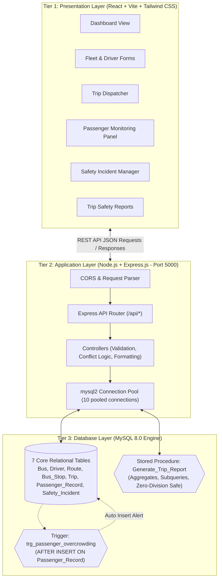
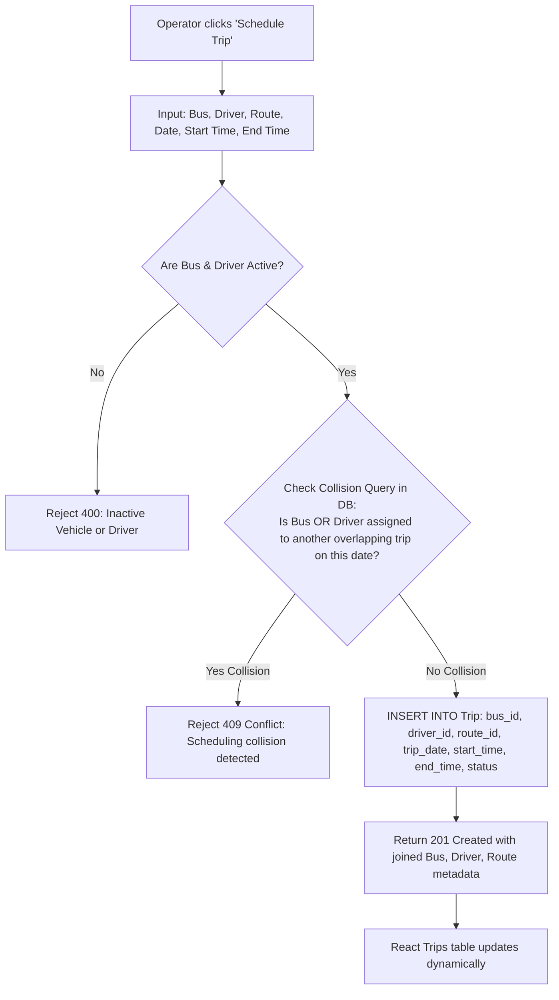
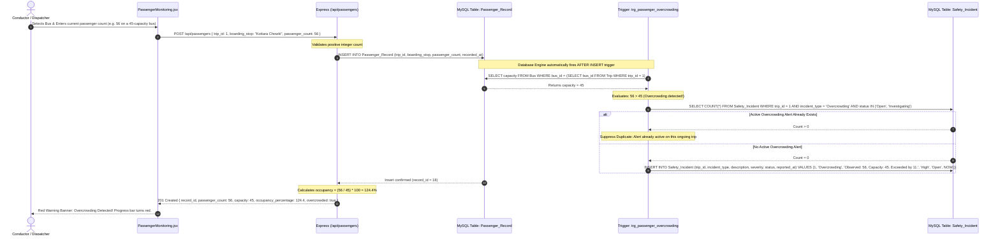
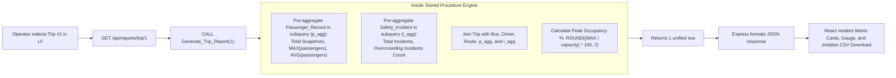

# Complete System Working & Technical Workflow Documentation
## Smart Bus Overcrowding & Passenger Safety Management System

**Course**: Database Management Systems (DBMS) Mini-Project  
**Architecture**: 3-Tier Web Application (Presentation, Application, Data)  
**Stack**: React 19 (Vite, Tailwind CSS) &bull; Node.js + Express.js &bull; MySQL 8.0+ (InnoDB)  

---

## 1. System Architecture & High-Level Overview

The system operates on an industry-standard **3-Tier Relational Architecture**. The database is not just a passive storage store; it functions as an active participant in business logic through automated triggers and stored procedures.



---

## 2. Core Functional Workflows

---

### Workflow 1: Route & Sequential Stop Onboarding (Atomic Transaction)

A public transit route is not just an origin and destination; it consists of an ordered sequence of intermediate stops. If route creation fails halfway through inserting stops, the database must not be left in an inconsistent state.

```mermaid
sequenceDiagram
    autonumber
    actor Admin as Transit Operator
    participant UI as React UI (RoutesPage)
    participant API as Express API (/api/routes)
    participant DB as MySQL Database

    Admin->>UI: Enters Route Name, Source, Destination, Distance & Stops list
    UI->>API: POST /api/routes { route_name, source, destination, stops: [...] }
    Note over API: Begins Database Transaction (START TRANSACTION)
    API->>DB: INSERT INTO Route (route_name, source, destination, distance_km)
    DB-->>API: Returns new route_id
    loop For each stop in stops array
        API->>DB: INSERT INTO Bus_Stop (route_id, stop_name, stop_order)
    end
    alt All inserts succeed
        Note over API: COMMIT Transaction
        API->>DB: COMMIT;
        API-->>UI: 201 Created { success: true, data: { route_id, name, stops: [...] } }
        UI-->>Admin: Displays Route with ordered stop badges
    else Any insert fails (e.g., duplicate stop_order)
        Note over API: ROLLBACK Transaction
        API->>DB: ROLLBACK;
        API-->>UI: 400 Bad Request { success: false, message: "..." }
        UI-->>Admin: Shows error alert; database remains clean
    end
```

---

### Workflow 2: Trip Dispatching & Collision Prevention

To maintain public safety and schedule reliability, the application layer prevents dispatch conflicts before committing records to the `Trip` table.



---

### Workflow 3: Passenger Snapshot Recording & Trigger Execution

This is the **primary DBMS demonstration flow**. When a transit conductor or sensor logs passenger numbers departing a stop, the database trigger independently evaluates overcrowding and logs safety violations.



---

### Workflow 4: Safety Incident Lifecycle & Resolution

Safety incidents follow an auditable state machine (`Open` &rarr; `Investigating` &rarr; `Resolved`).

```mermaid
stateDiagram-v2
    [*] --> Open: Trigger automatically creates 'Overcrowding' incident (or manual report)
    Open --> Investigating: Dispatcher acknowledges & investigates (feeder bus dispatched)
    Investigating --> Resolved: Issue resolved; supervisor clicks 'Resolve' in UI
    Open --> Resolved: Direct resolution
    
    note right of Resolved
        Automatic Timestamping:
        resolved_at = NOW()
        Duplicate alert suppression clears;
        new surges will log a fresh incident.
    end note

    Resolved --> Investigating: Reopened (resolved_at reset to NULL)
    Resolved --> Open: Reopened (resolved_at reset to NULL)
```



---

### Workflow 5: Analytical Trip Safety Report via Stored Procedure

When an auditor or manager inspects a trip, MySQL executes `Generate_Trip_Report(p_trip_id)`:



---

## 3. Database Engine Internals & Design Rationale

### 1. Point-in-Time Snapshot Semantics
- In this system, `passenger_count` is **not** an incremental delta of boarding passengers ($+5$ or $-2$).
- It is a **true physical census snapshot** of passengers present on the bus upon departing the stop.
- **Why?** Real-world public transit safety regulations penalize operating a bus whose instantaneous passenger load breaches gross vehicle weight ratings. Calculating safety compliance requires comparing instantaneous snapshots against legal vehicle capacity, not summing boarding totals.

### 2. Cartesian Product Prevention in Reporting
A classic pitfall when writing DBMS queries is joining multiple one-to-many child tables:
$$\text{Trip (1)} \longleftrightarrow \text{Passenger\_Record (M)} \quad \text{and} \quad \text{Trip (1)} \longleftrightarrow \text{Safety\_Incident (N)}$$
Joining them directly produces $M \times N$ rows (a Cartesian product). If a trip has 5 passenger records and 2 incidents, 10 joined rows result, doubling sums and falsifying averages.
- **The Stored Procedure Solution**: Derived pre-aggregations (`p_agg` and `i_agg`) group records by `trip_id` *before* the outer join, ensuring an exact 1:1 join onto the parent `Trip` record.

### 3. Comprehensive Referential Integrity Rules
- `Bus`, `Driver`, `Route`, and `Trip` use `ON DELETE RESTRICT`. Any attempt to delete a referenced entity throws MySQL error `1451`.
- The Express centralized error handler intercepts `1451` and delivers a clean HTTP `409 Conflict` response with an explanatory message.
- `Bus_Stop` uses `ON DELETE CASCADE` linked to `Route`. When a route without scheduled trips is deleted, its intermediate stops are automatically cleaned up.

---

## 4. Viva Examination Preparation: Q&A Defense

| Question | Technical Answer |
| :--- | :--- |
| **Why is the trigger implemented in MySQL rather than Express?** | Implementing the trigger at the database level guarantees data integrity regardless of the entry point. Whether data is inserted via the Express API, MySQL Workbench, mobile terminal, or bulk batch imports, the safety trigger is guaranteed to execute. |
| **Why does the trigger have duplicate prevention?** | During peak commute times, an overloaded bus may remain crowded across several consecutive stops. Duplicate prevention prevents flooding the `Safety_Incident` table with redundant rows, maintaining operational clarity for dispatchers. |
| **How does Express handle database connection pooling?** | Rather than opening and closing a TCP handshake on every HTTP request, `mysql2/promise` maintains a reusable pool of 10 connections. This reduces query latency from $\sim 50\text{ms}$ to $<2\text{ms}$. |
| **What indexes are created and why?** | B-Tree indexes are created on all foreign keys (`bus_id`, `driver_id`, `route_id`, `trip_id`) and commonly filtered status columns (`status`, `trip_date`). This converts $O(N)$ full table scans into $O(\log N)$ indexed lookups. |
| **What happens if bus capacity is 0?** | The database enforces `CHECK (capacity > 0)`. In addition, the stored procedure uses `CASE WHEN b.capacity > 0 ... ELSE 0.00 END` to prevent divide-by-zero crashes. |
